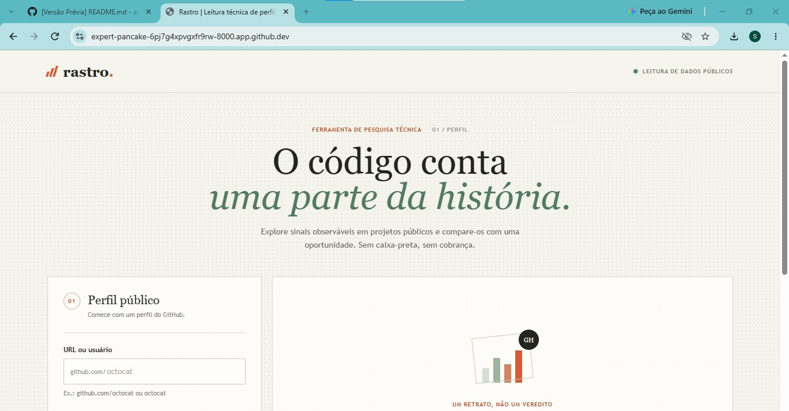
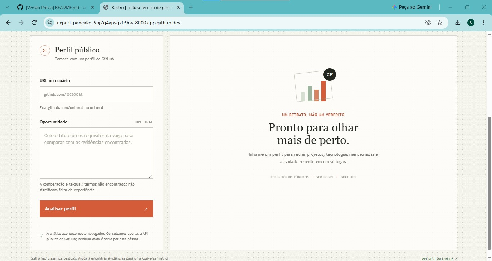
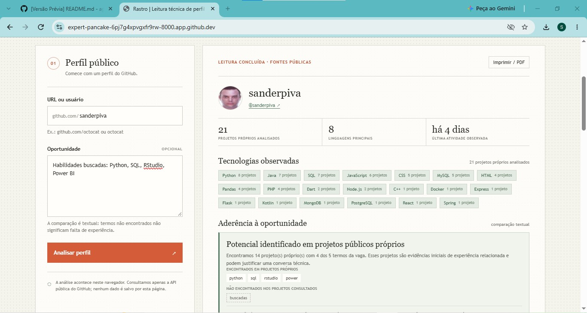
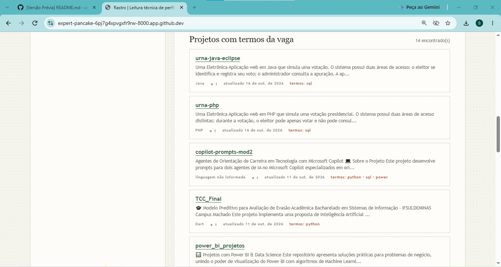
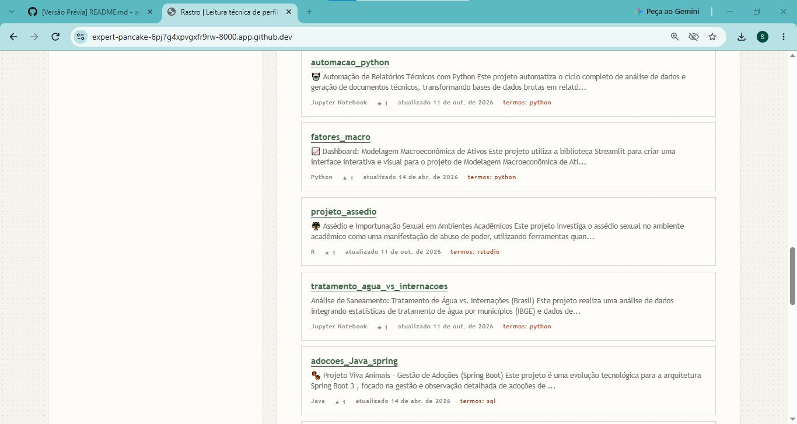
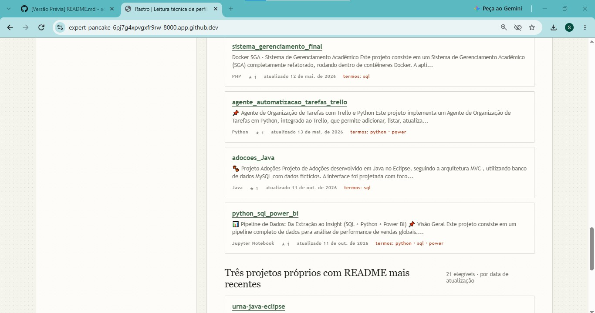
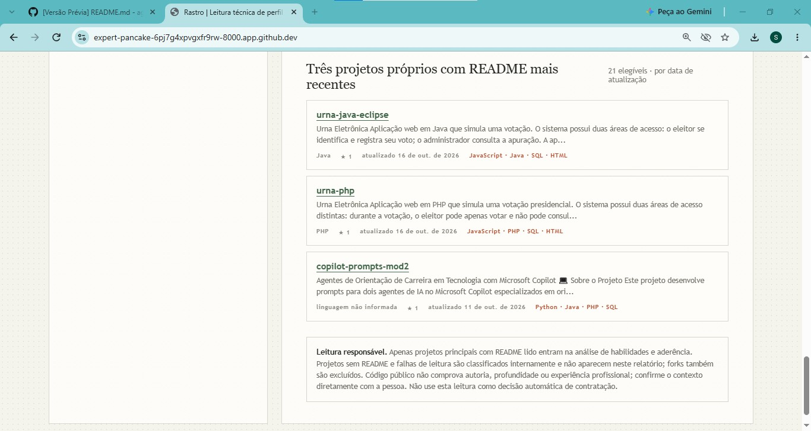

# Rastro

Protótipo gratuito para reunir evidências técnicas em repositórios públicos do GitHub e compará-las, por palavras-chave, com uma oportunidade.

## Objetivo

Explorar o potencial do GitHub Copilot na concepção e implementação do agente Rastro, bem como realizar testes de performance, otimizações e melhorias contínuas sob demanda.

## Executar

Não há dependências nem build. Sirva a pasta com qualquer servidor HTTP local, por exemplo:

```sh
python3 -m http.server 8000
```

Depois, abra `http://localhost:8000`.

## Como funciona

- Consulta a API REST pública do GitHub diretamente no navegador, sem token, backend ou serviço pago.
- Analisa até 300 repositórios públicos mais recentemente atualizados e procura os READMEs de cada projeto sem autenticação.
- Analisa até 300 repositórios próprios mais recentemente atualizados; forks são excluídos dos dados, READMEs e resultados.
- Apenas projetos com README lido entram na avaliação de habilidades e potencial para a vaga. Os termos são comparados com o nome, descrição, tópicos, linguagem e conteúdo do README.
- Consolida repositórios somente quando o README de um contém um link explícito para o outro. O repositório que contém o link é o principal; os READMEs do grupo contribuem internamente para a busca, mas só o principal é exibido.
- Repositórios parecidos sem link entre si continuam sendo analisados separadamente. Projetos sem README, falhas de leitura e repositórios relacionados consolidados ficam fora do relatório.
- Lista os projetos principais correspondentes e os três principais elegíveis mais recentes.
- Mostra uma conclusão explicável com termos encontrados e ausentes e os projetos que sustentam o potencial relacionado à oportunidade.
- Não salva os dados; é possível imprimir ou salvar o resultado como PDF pelo navegador.

As consultas de perfil sem autenticação estão sujeitas ao limite de requisições do GitHub por endereço IP. A análise textual de projetos com README identifica sinais, não comprova autoria, profundidade ou experiência; termos ausentes não significam falta de habilidade. Use o resultado como ponto de partida para uma conversa, nunca como critério automático de contratação. Considere também que repositórios públicos podem conter dados pessoais publicados pelo próprio usuário.

## Fotos sistema em operação
<hr>
<div align="center">
   
</div><hr>
<div align="center">
   
</div><hr>
<div align="center">
   
</div><hr>
<div align="center">
   
</div><hr>
<div align="center">
   
</div><hr>
<div align="center">
   
</div><hr>
<div align="center">
   
</div><hr>

**Autoria**: Sander Gustavo Piva
